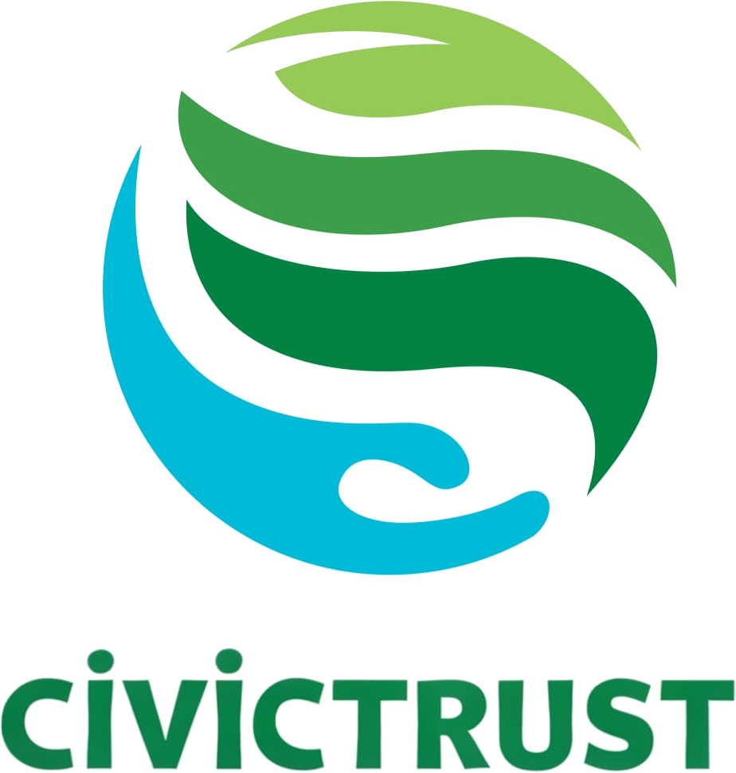
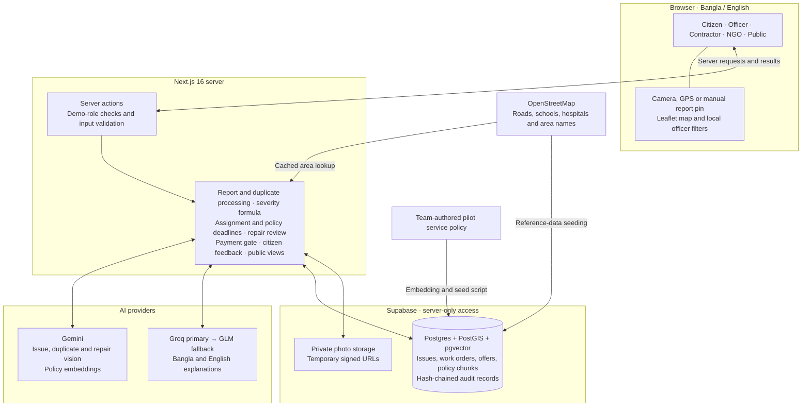

<p align="center"></p>

# CivicTrust

**Report it. AI ranks it. The city fixes it. AI checks the fix.**

**Live demo:** <https://civictrust-five.vercel.app> (no login; choose a role)

Citizens photograph potholes, road cracks, garbage piles, open drains and waterlogging. AI identifies the problem and supports an explainable urgency score. A ward officer assigns a contractor or NGO with a deadline, and repair evidence is checked before the issue is marked fixed and payment becomes eligible. A public portal shows issue progress and contractor outcomes by area.

Entry for the **International AI Builders Congress 2026** — Competition 1 (Team-Built Product), **CivicSphere AI** domain, **Transparent Government** challenge (*"Open, accountable public-spending and service insight"*). The prototype demonstrates accountability through repair verification, a payment eligibility gate, tamper-evident audit records and public contractor scorecards.

| Document | What's in it |
|---|---|
| [`CivicTrust.pdf`](CivicTrust.pdf) | Product brief, preliminary compliance status, AI models, and architecture |
| [`PROTOTYPE_PLAN.md`](PROTOTYPE_PLAN.md) | Plan mapped to the judging rubric: status, video script, timeline, risks, judge Q&A |
| [`PRELIMINARY_PROTOTYPE_REQUIREMENTS.md`](PRELIMINARY_PROTOTYPE_REQUIREMENTS.md) | Requirements and acceptance criteria for the preliminary-round prototype |
| [`web/README.md`](web/README.md) | Developer setup and code layout |
| [`Docs/KPI_SUMMARY.md`](Docs/KPI_SUMMARY.md) | Expected outcomes, KPIs and how they are measured |
| [`Docs/PRELIMINARY_CHECKLIST.md`](Docs/PRELIMINARY_CHECKLIST.md) | Remaining work for the preliminary submission, with owners |
| [`Docs/SUBMISSION_FORM_ANSWERS.md`](Docs/SUBMISSION_FORM_ANSWERS.md) | Draft answers for the Cloudcamp submission form |
| [`TEST.md`](TEST.md) | How to test and debug the prototype: scenarios per role, common problems, known issues |
| [`AIBC_Participants_Guide_261015_143157.pdf`](AIBC_Participants_Guide_261015_143157.pdf) | Participant guide for the AI Builders Congress |

---

## Why it's different

CivicTrust **verifies the outcome**. Automatic approval requires a fresh after-photo captured after assignment, measured GPS within 15 m, and a confident AI comparison confirming the same place and a resolved problem. Partial, unclear or unavailable AI results go to an officer. Citizen disputes reopen review and withhold payment that has not already been released.

## Roles

| Role | What they do |
|---|---|
| Citizen | Report with a photo, view a live AI assessment, track the fix, confirm or dispute it |
| Ward officer | Review the ranked queue and map, correct AI results, assign work, review repairs and release eligible payment status |
| Contractor | Receive work orders, upload proof of repair |
| NGO / volunteers | Offer to help with open issues; the officer decides by assigning the work |
| Public | See issue progress, an activity log, area statistics and contractor scorecards |

The prototype has **no login**: a role switcher gives one-click access so judges can try every role.

## How the AI works

| Step | Model | What it does |
|---|---|---|
| M1 Issue detector | Gemini vision | Issue type, visual severity, hazards, privacy flags; rejects non-civic photos |
| M2 Severity score | Transparent formula | 1–10 from the photo + road class + distance to schools/hospitals + reports + days open; every factor is shown |
| M3 Duplicate filter | PostGIS + Gemini | Searches open issues within 25 m and merges confident visual matches |
| M4 Repair verifier | GPS + time + Gemini | Checks freshness, location and before/after evidence; routes uncertain repairs to officer review |
| Explanation | Groq primary, GLM fallback | One-line reason in Bangla and English, written only from computed facts |
| Policy RAG | Gemini embeddings + pgvector | Retrieves the pilot policy citation for repair deadlines |

The score is computed in code; text models explain its inputs. AI calls have timeouts. If both explanation providers fail, factual observations remain available; an unavailable repair verifier requires officer review.

## Architecture



The server owns workflow decisions and database writes. The officer page loads the authorized pilot queue in pages, then filters the table and map in the browser; each filter selection avoids a new database request. Opening issue details uses server data, and successful workflow actions refresh the queue.

Road and facility data come from OpenStreetMap. Public figures use official wards when boundaries are loaded, otherwise recorded OpenStreetMap areas; these areas are not official ward boundaries. Policy retrieval uses Gemini embeddings and pgvector, with severity-based deadline rules available if retrieval fails.

## Safeguards

- Row-level security on application tables; the database secret key stays in server code
- Tamper-evident audit log: hash-chained and append-only, records workflow events and AI corrections
- Officers can correct issue assessments and review repairs, with reasons recorded
- Extra-report bonus capped to limit the influence of report volume on urgency
- Browser photo processing removes original EXIF metadata; public results exclude exact coordinates and citizen names
- Private photo storage with temporary signed URLs; Gemini image requests specify `store: false`

## Prototype status

| Area | Implemented |
|---|---|
| Citizen reporting | Photo submission, GPS or manual pin, live AI assessment, duplicate merging, severity breakdown and repair feedback |
| Officer workflow | Queue and map, local status/type/area filters, issue history, AI corrections, assignment, repair review and payment status |
| Contractor and NGO | Assigned work, repair evidence, verification results and NGO offers to help |
| Public transparency | Issue progress, activity log, area statistics, contractor scorecards and audit-chain verification |
| Impact and measurement | `/impact` page with live KPIs and sample sizes; `pnpm kpi` and labelled-photo evaluation scripts |
| Supporting pages and tools | Architecture, data, security and model-card pages; migrations and reference-data seeding |

This is a preliminary prototype. Role switching uses demonstration personas, payment release changes a recorded status, and no bank transfer is made. Official ward boundaries, production authentication and city-wide deployment are outside the current demonstration setup.

Use [`TEST.md`](TEST.md) for acceptance scenarios. Measured figures appear on the `/impact` page with their sample sizes; the method is described in [`Docs/KPI_SUMMARY.md`](Docs/KPI_SUMMARY.md). Classification accuracy, repair accuracy and real-world impact are reported only once measured on representative data. Scope and remaining work are tracked in [`PROTOTYPE_PLAN.md`](PROTOTYPE_PLAN.md).

## Hosting

The app runs on Vercel in Singapore (`sin1`), next to the Supabase database in Singapore (`ap-southeast-1`), the closest Supabase region to Bangladesh. Bangladesh's Personal Data Protection Ordinance 2025 requires restricted data to stay in the country, so a real rollout moves the database to Bangladesh-hosted or self-hosted Postgres.

## Run it locally

Requires Node 24 (`nvm use` reads `.nvmrc`) and pnpm.

```bash
cd web
pnpm install
cp .env.example .env.local    # add Supabase, Gemini, Groq and GLM keys (ask the team lead)
pnpm dev                      # http://localhost:3000
```

Database setup, data seeding and all scripts: [`web/README.md`](web/README.md).

## Working on this repo

- Branch from `main`, open a pull request; CI runs tests, typecheck, lint and build.
- **Never commit `web/.env.local`** or paste keys into code, issues or chat. It is git-ignored; don't force-add anything under `web/`.
- Every AI result shown in a demo must be computed live. Fabricated results disqualify the team.

## Team

| Role (required by the Congress) | Member |
|---|---|
| Team Leader / Coordinator | *to confirm* |
| Business Analyst / Data Scientist | *to confirm* |
| UI/UX / Frontend Developer | Sajid (GitHub `Sajid-Z`) |
| Backend / Data Engineer | Md. Jahidul Islam |
| Presentation / Communication Lead | *to confirm* |

Deployment (Vercel) is run by Md. Irfan Iqbal (repository owner). Each role must name one member before submission.

## AI tools used

Declared as the Congress rules require.

| Tool | Used for |
|---|---|
| Google Gemini (`gemini-3.8-flash`, `gemini-embedding-001`) | In the product: photo analysis, duplicate check, repair verification, policy search |
| Groq (`openai/gpt-oss-120b`), GLM (`glm-4.5-flash`, fallback) | In the product: one-line Bangla/English explanations from computed facts |
| OpenStreetMap Nominatim | In the product: road and area names for a location (not AI) |
| Claude Code (Anthropic) | In development: writing and reviewing code, tests, database migrations and documentation, with team review |

## Data and licences

- Map data © [OpenStreetMap](https://www.openstreetmap.org/copyright) contributors, ODbL 1.0
- Pilot service policy in `web/data/policy/` is written by the team; it is not an official city regulation
- Code: [MIT](LICENSE)
