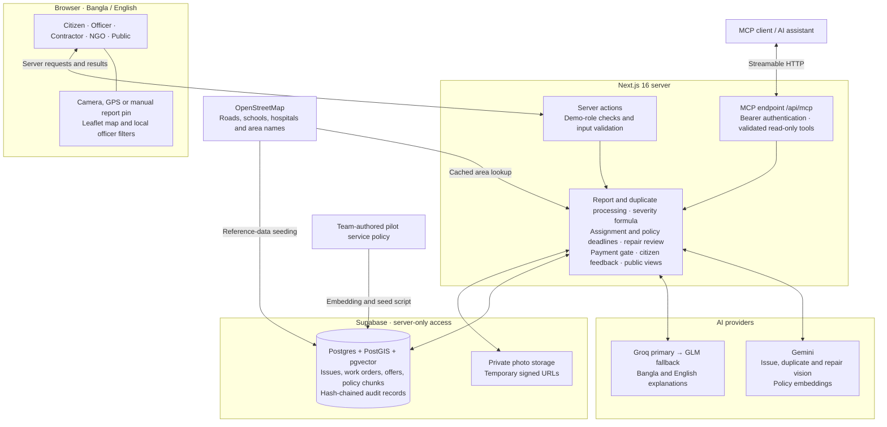

<div align="center">


# CivicTrust
### *Report it. AI ranks it. The city fixes it. AI checks the fix.*

**App and language**

[](https://nextjs.org/)
[](https://react.dev/)
[](https://www.typescriptlang.org/)
[](https://tailwindcss.com/)
[](https://nodejs.org/)
[](https://pnpm.io/)
[](https://zod.dev/)
[](https://recharts.org/)
[](https://lucide.dev/)
[](https://github.com/MikeKovarik/exifr)

**AI**

[](https://ai.google.dev/)
[](https://groq.com/)
[](https://open.bigmodel.cn/)
[](https://ollama.com/)
[](https://qwenlm.github.io/)
[](https://mastra.ai/)
[](https://ai-sdk.dev/)
[](https://modelcontextprotocol.io/)

**Data and maps**

[](https://supabase.com/)
[](https://www.postgresql.org/)
[](https://postgis.net/)
[](https://github.com/pgvector/pgvector)
[](https://leafletjs.com/)
[](https://www.openstreetmap.org/)
[](https://nominatim.org/)

**Hosting, automation and tooling**

[](https://vercel.com/)
[](https://n8n.io/)
[](https://www.docker.com/)
[](https://developers.cloudflare.com/cloudflare-one/connections/connect-networks/)
[](https://github.com/features/actions)
[](https://eslint.org/)
[](https://ngrok.com/)
[](https://claude.com/claude-code)

<p align="center">
  <strong>Live demo: <a href="https://civictrust-eight.vercel.app">civictrust-eight.vercel.app</a> (no login; choose a role) · Backup: <a href="https://civic-trust-siuu.vercel.app">civic-trust-siuu.vercel.app</a></strong>
</p>

<p align="center">
  Citizens photograph potholes, road cracks, garbage piles, open drains and waterlogging. AI identifies the problem and supports an explainable urgency score. A ward officer assigns a contractor or NGO with a deadline, and repair evidence is checked before the issue is marked fixed and payment becomes eligible. A public portal shows issue progress and contractor outcomes by area.
</p>

<p align="center">
  <em>Entry for the <strong>International AI Builders Congress 2026</strong> — Competition 1 (Idea to Unicorn — Team-Built Product), <strong>CivicSphere AI</strong> domain, <strong>Transparent Government</strong> challenge ("Open, accountable public-spending and service insight"). The prototype demonstrates accountability through repair verification, a payment eligibility gate, tamper-evident audit records and public contractor scorecards.</em>
</p>

---

</div>

| Document | What's in it |
|---|---|
| [`CivicTrust.pdf`](CivicTrust.pdf) | Product brief (4 pages, 20 Nov): scope, workflow, AI components, architecture, safeguards and what has been verified. Live figures are on the demo's `/docs` and `/impact` pages |
| [`Docs/CivicTrust_One_Page_Summary-1.pdf`](Docs/CivicTrust_One_Page_Summary-1.pdf) | One-page summary for the preliminary round: problem, users, how it works, impact |
| [`PROTOTYPE_PLAN.md`](PROTOTYPE_PLAN.md) | Plan mapped to the judging rubric: status, video script, timeline, risks, judge Q&A |
| [`PRELIMINARY_PROTOTYPE_REQUIREMENTS.md`](PRELIMINARY_PROTOTYPE_REQUIREMENTS.md) | Requirements and acceptance criteria for the preliminary-round prototype |
| [`web/README.md`](web/README.md) | Developer setup and code layout |
| [`Docs/KPI_SUMMARY.md`](Docs/KPI_SUMMARY.md) | Expected outcomes, KPIs and how they are measured |
| [`Docs/MCP_GUIDE.md`](Docs/MCP_GUIDE.md) | Six read-only MCP tools, client setup, verification and submission evidence |
| [`automation/`](automation) | n8n workflow for the daily overdue check; token-checked gateway and Cloudflare Tunnel for the local model |
| [`Docs/PRELIMINARY_CHECKLIST.md`](Docs/PRELIMINARY_CHECKLIST.md) | Remaining work for the preliminary submission, with owners |
| [`TEST.md`](TEST.md) | How to test and debug the prototype: scenarios per role, troubleshooting, operating notes |
| [`AIBC_Participants_Guide_261015_143157.pdf`](AIBC_Participants_Guide_261015_143157.pdf) | Participant guide for the AI Builders Congress |

---

## Why it's different

CivicTrust **verifies the outcome**. Automatic approval requires a fresh after-photo captured after assignment, measured GPS within 15 m, and a confident AI comparison confirming the same place and a resolved problem. Partial, unclear or unavailable AI results go to an officer. Citizen disputes reopen review and withhold payment that has not already been released.

## Roles

| Role | What they do |
|---|---|
| Citizen | Report with a photo, view a live AI assessment, track the fix, confirm or dispute it |
| Ward officer | Review the ranked queue and map, correct AI results, assign work, review repairs and release eligible payment status |
| Contractor | Receive work orders, upload proof of repair |
| NGO / volunteers | Offer to help with open issues; the officer decides by assigning the work |
| Public | See issue progress, an activity log, area statistics and contractor scorecards |

The prototype has **no login**: a role switcher gives one-click access so judges can try every role.

## How the AI works

| Step | Model | What it does |
|---|---|---|
| M1 Issue detector | Gemini vision | Issue type, visual severity, hazards, privacy flags; rejects non-civic photos |
| M2 Severity score | Transparent formula | 1–10 from the photo + road class + distance to schools/hospitals + reports + days open; every factor is shown |
| M3 Duplicate filter | PostGIS + Gemini | Searches open issues within 25 m and merges confident visual matches |
| M4 Repair verifier | GPS + time + Gemini | Checks freshness, location and before/after evidence; routes uncertain repairs to officer review |
| Explanation | Groq primary, GLM fallback, optional local model (Ollama) | One-line reason in Bangla and English, written only from computed facts |
| Policy RAG | Gemini embeddings + pgvector | Retrieves the pilot policy citation for repair deadlines |
| Officer assistant | Mastra agent on Groq | "Ask CivicTrust" answers officers' questions with seven read-only tools and cites the records it used; it cannot change anything |

The score is computed in code; text models explain its inputs. AI calls have timeouts. If every explanation provider fails, factual observations remain available; an unavailable repair verifier requires officer review.

## Architecture



The server owns workflow decisions and database writes. The officer page loads the authorized pilot queue in pages, then filters the table and map in the browser; each filter selection avoids a new database request. Opening issue details uses server data, and successful workflow actions refresh the queue.

Road and facility data come from OpenStreetMap. Public figures use official wards when boundaries are loaded, and recorded OpenStreetMap areas until then. Policy retrieval uses Gemini embeddings and pgvector, with severity-based deadline rules available if retrieval fails.

## Safeguards

- Row-level security on application tables; the database secret key stays in server code
- Tamper-evident audit log: hash-chained and append-only, records workflow events and AI corrections
- Officers can correct issue assessments and review repairs, with reasons recorded
- Extra-report bonus capped to limit the influence of report volume on urgency
- Browser photo processing removes original EXIF metadata; public results exclude exact coordinates and citizen names
- Private photo storage with temporary signed URLs; Gemini image requests specify `store: false`

## Prototype status

| Area | Implemented |
|---|---|
| Citizen reporting | Photo submission, GPS or manual pin, live AI assessment, duplicate merging, severity breakdown and repair feedback |
| Officer workflow | Queue and map, local status/type/area filters, issue history, AI corrections, assignment, repair review, payment status, overdue flags and the "Ask CivicTrust" assistant |
| Contractor and NGO | Assigned work, repair evidence, verification results and NGO offers to help |
| Public transparency | Issue progress, activity log, area statistics, contractor scorecards and audit-chain verification |
| Impact and measurement | `/impact` page with live KPIs and sample sizes; `pnpm kpi` and labelled-photo evaluation scripts |
| Supporting pages and tools | Architecture, data, security and model-card pages; migrations and reference-data seeding |
| MCP integration | Six read-only tools over authenticated Streamable HTTP; shared backend functions and an SDK smoke client. All six tools pass on both deployments (checked 20 Nov); see [`Docs/MCP_VERIFICATION.md`](Docs/MCP_VERIFICATION.md). |
| Automation | Daily overdue-repair check (`/api/automation/overdue`), run by Vercel Cron or the self-hosted n8n workflow in [`automation/n8n`](automation/n8n); records each late work order once in the audit log and public update log, with a dry-run mode |
| Local model | Optional Ollama fallback for explanations (`qwen2.5:3b`, chosen with `pnpm eval:local-models`); reachable from the hosted app through the token-checked tunnel in [`automation/ollama-tunnel`](automation/ollama-tunnel) |

This preliminary prototype uses demonstration personas for role switching and records payment release as a status. Official ward boundaries, production sign-in, bank transfers and city-wide deployment are the next stage of the rollout.

Use [`TEST.md`](TEST.md) for acceptance scenarios. Measured figures appear on the `/impact` page with their sample sizes; the method is described in [`Docs/KPI_SUMMARY.md`](Docs/KPI_SUMMARY.md). Classification accuracy, repair accuracy and real-world impact will be reported from the city pilot on representative data. Scope and remaining work are tracked in [`PROTOTYPE_PLAN.md`](PROTOTYPE_PLAN.md).

## Hosting

The app runs on Vercel in Singapore (`sin1`), next to the Supabase database in Singapore (`ap-southeast-1`), the closest Supabase region to Bangladesh. Bangladesh's Personal Data Protection Ordinance 2025 requires restricted data to stay in the country, so a real rollout moves the database to Bangladesh-hosted or self-hosted Postgres.

## Run it locally

Requires Node 24 (`nvm use` reads `.nvmrc`) and pnpm.

```bash
cd web
pnpm install
cp .env.example .env.local    # add Supabase, Gemini, Groq and GLM keys
pnpm dev                      # http://localhost:3000
```

Database setup, data seeding and all scripts: [`web/README.md`](web/README.md).

## Team

| Role (required by the Congress) | Member |
|---|---|
| Team Leader / Coordinator | Shadman Zaman Sajid ([Sajid-Z](https://github.com/Sajid-Z)) |
| Business Analyst / Data Scientist | Swarlok Samadder ([Swarlok](https://github.com/Swarlok)) |
| UI/UX / Frontend Developer | Shadman Zaman Sajid ([Sajid-Z](https://github.com/Sajid-Z)) |
| Backend / Data Engineer | Md. Jahidul Islam ([Jahidul183019](https://github.com/Jahidul183019)) & Md. Abdullah Bin Sorwar Chowdhury ([abdullahsorwar](https://github.com/abdullahsorwar)) |
| Presentation / Communication Lead | Md. Irfan Iqbal ([Ir-Rafi](https://github.com/Ir-Rafi)) |

Deployment (Vercel) is run by Md. Irfan Iqbal (repository owner).

## AI tools used

Declared as the Congress rules require.

| Tool | Used for |
|---|---|
| Google Gemini (`gemini-3.8-flash`; backups `gemini-3.6-flash`, `gemini-3-flash-preview`, `gemini-3.1-flash-lite`; `gemini-embedding-001`) | In the product: photo analysis, duplicate check, repair verification, policy search |
| Groq (`openai/gpt-oss-120b`), GLM (`glm-4.7-flash`, fallback) | In the product: one-line Bangla/English explanations from computed facts |
| Mastra agent on Groq (`openai/gpt-oss-120b`) | In the product: the "Ask CivicTrust" officer assistant, with read-only tools |
| Ollama with Qwen 2.5 3B (optional, local) | In the product: last fallback for explanations where configured; Llama 3.2 3B and Gemma 2/3 were compared with `pnpm eval:local-models` |
| OpenStreetMap Nominatim | In the product: road and area names for a location (not AI) |
| Claude Code (Anthropic) | In development: writing and reviewing code, tests, database migrations and documentation, with team review |

## Data and licences

- Map data © [OpenStreetMap](https://www.openstreetmap.org/copyright) contributors, ODbL 1.0
- Pilot service policy in `web/data/policy/` is written by the team, ready to be replaced by the city's own rules
- Code: [MIT](LICENSE)
